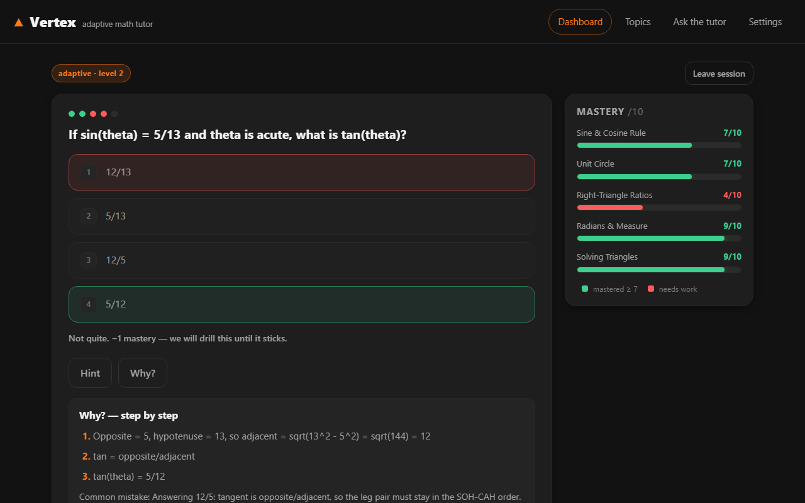

# Vertex — adaptive math tutor

> **Every question, one step up.**

**NotebookLM knows your documents. Vertex knows you.**

## What it does

- **Adaptive difficulty** — each topic starts at your level; two correct in a row push you up a tier, two wrong pull you back down.
- **Mastery bars (0–10)** — five live bars per topic; every answer moves one bar +1 or −1, with a mastery threshold of 7.
- **Closed-loop drill** — get a concept wrong and the quiz keeps feeding you exactly that weakest concept until its bar fills. No gaps left behind.
- **Step-by-step "Why?" + ELI5** — every answer comes with worked steps and a simpler-explanation toggle.
- **Hints with a real cost** — use the hint and a correct answer gains zero mastery. Comfort food for the ego, bad for the bar.
- **Personalized revision PDF** — export a sheet built from *your own* mistakes (with solutions) plus the topic's formulas and rules.
- **Tutor chat** — runs on BharatCode's `qwen-3.8-27b` for explanations, with instant canned fallbacks and an "offline mode" chip so the demo never breaks.

## Run

Open `index.html` — no setup, no build step, no dependencies. Just double-click it.

Add your BharatCode API key in Settings — stored only in your browser (localStorage), never committed or logged. Without a key the app is fully usable: the tutor chat answers from curated offline fallbacks.

## How the engine works (tech note)

The core is a **deterministic mastery engine — the LLM is never in the quiz loop**.
Mastery is an integer 0–10 per concept; each answer moves it ±1 (clamped), and ≥7 means mastered.
In-session difficulty moves ±1 after 2 correct / 2 wrong in a row.
The drill loop always selects the lowest-scoring unmastered concept and serves its hardest eligible unasked question.
The LLM only writes "Why?" explanations and tutor chat, both with canned fallbacks; all quiz answers are curated and re-derived twice, so they are never wrong.

## 90-second demo

1. Open `index.html` — the dashboard is auto-seeded: streak 4, mastery bars at 6 / 6 / 6 / 9 / 9.
2. Start the Trigonometry quiz and answer right, right — two bars hit 7 and turn green.
3. Answer two questions wrong on purpose — the bars fall red and the drill **locks onto SOH-CAH-TOA**, feeding it only that concept.
4. Answer three in a row right — the bar refills to 7 and you get the mastered screen.
5. Export your revision PDF — it is built from the mistakes you just made.
6. Ask the tutor chat one question (works with no API key via the offline fallback).

## Files

| File | What's in it |
|---|---|
| `index.html` | All views, settings modal, print area |
| `styles.css` | Dark theme, orange accent, responsive, print stylesheet |
| `app.js` | Mastery engine, state machine, rendering, persistence |
| `chat.js` | BharatCode API client + canned offline fallback (3 s timeout) |
| `data/topics.js` | Topic map + full Trigonometry pack (22 curated questions) |
| `BharatCode.txt` | Hackathon-required project description |
| `verify.mjs` | Dev-only contract checker (not loaded by the app) |

Contract checks: run `node verify.mjs` from the repo root — it validates the schema, the seed math, and simulates the full 7-tap demo arc independently.

## Privacy

Everything stays in your browser's localStorage (scores, streak, mistake log, API key). Nothing leaves your machine except the chat request to the BharatCode API when *you* add a key.

## Status

Local-only build — not yet pushed or published. Intended repo: `nihalpurohit2211-maker/vertex-adaptive-math-tutor` (to be published). No live URL to announce yet.

## License

MIT.
